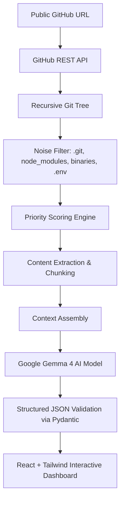

# 🚀 GitHub Project Explainer (Powered by Google Gemma 4)

[](https://ai.google.dev/gemma)
[](https://fastapi.tiangolo.com/)
[](https://vitejs.dev/)
[]()

> **Turn complex GitHub repositories into simple, beginner-friendly explanations with deep code inspection, visual architecture graphs, and zero-hallucination interactive AI guidance.**

---

## 📌 Problem Statement

Open-source codebases are notoriously intimidating for beginners and junior developers. Newcomers open a repository, encounter hundreds of files, cryptic directory structures, build configs, and obscure abbreviations, and are left with questions:
- *What does this project actually do?*
- *How does data flow from the UI to the database?*
- *Where is authentication implemented?*
- *Which file should I modify to make a change?*

Most AI summaries merely repeat the `README.md`. **GitHub Project Explainer** solves this problem by actually inspecting the repository tree, filtering noise, reading critical source and configuration files, analyzing component relationships, and providing structured, evidence-backed explanations that anyone can understand.

---

## ✨ Core Features

| Feature | Description |
| :--- | :--- |
| **🧠 Gemma 4 Codebase Analysis** | Powered by Google Gemma 4 via the official Google GenAI SDK with beginner-friendly analogies. |
| **🔍 Intelligent Repository Pipeline** | Recursively scans the Git tree, ignores build artifacts/binaries/secrets, scores files, and extracts relevant code within token budgets. |
| **🛠️ Verified Tech Stack** | Identifies libraries and frameworks **strictly when supported by repository evidence** (e.g. package manifests, config files). |
| **🗺️ Repository Structure** | Explains folder hierarchies and what each key directory is responsible for. |
| **🏛️ Visual Architecture Graph** | Interactive component flow diagram (Frontend → API → Backend → Database) with inferred vs. documented indicators. |
| **🌊 Main Execution Code Flow** | Step-by-step walkthrough showing sequential data flow from user interaction to program execution. |
| **📁 Interactive File Explorer** | Recursive tree explorer with syntax-highlighted code preview (PrismJS) and line numbers. |
| **✨ "Explain This File"** | 1-click line-by-line file breakdown explaining purpose, functions, inputs/outputs, and relationships. |
| **💬 "Ask AI" Grounded Chat** | Context-aware Q&A interface strictly grounded in repository files that refuses to hallucinate unprovided code. |
| **🚀 Verified How-To-Run Guide** | Extracts exact setup and execution commands from `package.json`, `requirements.txt`, or `README.md`. |
| **⚡ 1-Click Demo Repositories** | Pre-configured popular starter repositories (Redux, FastAPI, Express, Chalk) for instant exploration. |

---

## 🏗️ Architecture & Pipeline Flow



### Repository Analysis Engine Pipeline
1. **URL Parsing**: Validates and normalizes `owner/repo` from standard GitHub URLs.
2. **Metadata Fetch**: Retrieves repository stars, forks, default branch, primary language, and license.
3. **Tree Inspection**: Fetches recursive Git tree via GitHub API.
4. **File Filtering**: Excludes `.git`, `node_modules`, `dist`, `build`, `__pycache__`, binaries, locks, and `.env` files.
5. **Priority Scoring**: Ranks files based on architectural significance:
   - *Tier 1*: `README.md`, `package.json`, `requirements.txt`, `Dockerfile`, `go.mod`, `Cargo.toml`.
   - *Tier 2*: Entrypoints (`main.*`, `app.*`, `index.*`, `server.*`, `App.*`).
   - *Tier 3*: Architectural folders (`routes/`, `controllers/`, `models/`, `services/`, `components/`).
6. **Chunking & Token Budgeting**: Enforces maximum file byte limits and total context window constraints.
7. **Gemma 4 Synthesis**: Returns structured JSON validated against Pydantic models.
8. **Contextual Fallback Engine**: If no API key is provided, safely runs an offline grounded analyzer so the application is immediately demo-ready.

---

## 🛠️ Technology Stack

### Backend
- **Language**: Python 3.12+
- **Framework**: FastAPI (Asynchronous REST API)
- **AI SDK**: Official `google-genai` SDK
- **AI Model**: Google Gemma 4 (`gemma-2-27b-it` or configurable)
- **HTTP Client**: `httpx` (Async HTTP requests to GitHub API)
- **Validation**: Pydantic v2 & Pydantic-Settings
- **Server**: Uvicorn ASGI Server

### Frontend
- **Framework**: React 19 + Vite
- **Styling**: Tailwind CSS v4 (Glassmorphism & dark developer aesthetic)
- **Icons**: Lucide React
- **Code Highlighting**: PrismJS (Tomorrow Dark Theme)
- **Visuals & Graphics**: OGL WebGL Fluid Simulation (`MicroSlats`), Canvas Confetti & interactive architecture diagrams

---

## 🔐 Environment Variables

Create a `.env` file in the project root or in `backend/`:

```bash
# Google Gemini / Gemma API Key (Obtain from Google AI Studio: https://aistudio.google.com/)
GEMINI_API_KEY=your_gemini_api_key_here

# Gemma Model (Default: gemma-2-27b-it)
GEMMA_MODEL=gemma-2-27b-it

# GitHub Personal Access Token (Optional: Increases rate limit from 60 to 5,000 req/hr)
# Generate at: https://github.com/settings/tokens (no special scopes needed for public repos)
GITHUB_TOKEN=your_github_token_here

# Server Settings
HOST=0.0.0.0
PORT=8000
DEBUG=true

# Analysis Limits
MAX_REPO_FILES=35
MAX_FILE_SIZE_BYTES=50000
```

---

## 🚀 Quickstart Guide

### 1. Prerequisites
- Python 3.12+ installed
- Node.js v18+ and npm installed

### 2. Backend Setup
```bash
# Navigate to backend directory
cd backend

# Create virtual environment
python -m venv venv

# Activate virtual environment
# Windows:
venv\Scripts\activate
# Linux/macOS:
source venv/bin/activate

# Install dependencies
pip install -r requirements.txt

# Configure environment variables
cp .env.example .env
# Edit .env and insert your GEMINI_API_KEY (optional, app includes demo fallback)

# Run FastAPI server
uvicorn main:app --host 127.0.0.1 --port 8000 --reload
```
Backend will be available at: `http://127.0.0.1:8000`  
API Swagger Docs: `http://127.0.0.1:8000/docs`

### 3. Frontend Setup
```bash
# Open a new terminal in the frontend directory
cd frontend

# Install dependencies
npm install

# Start Vite dev server
npm run dev
```
Frontend will be available at: `http://127.0.0.1:5173`

---

## 🧪 Testing the Application

1. Open `http://127.0.0.1:5173/` in your browser.
2. Either paste any public GitHub repository URL (e.g. `https://github.com/expressjs/express`) or click one of the instant demo buttons (`Redux Todo List`, `FastAPI`, `Express.js`, `Chalk`).
3. Click **"Analyze Repository"**.
4. Explore the dashboard tabs:
   - **Overview & Stack**: Read the beginner analogy and verify tech stack evidence.
   - **Repository Structure**: Check folder responsibilities and important files.
   - **Architecture & Flow**: Inspect interactive component nodes and main code flow.
   - **File Explorer**: Browse the tree, view syntax-highlighted code, and click **"Explain This File"**.
   - **Ask AI**: Test questions like *"Where does the program start?"* or *"Explain this project like I'm 5"*.
   - **How To Run**: Copy verified installation and execution commands.

---

## 🔒 Security & Guardrails

- **Zero Secret Exposure**: `.env` and credential files (`.pem`, `.key`) are strictly blocked from being analyzed or exposed to AI prompts.
- **Client Key Isolation**: API keys remain exclusively on the FastAPI backend; the frontend never handles credentials.
- **Zero Hallucination Enforcement**: Strict system instructions command Gemma 4 to answer exclusively using provided context and state when information is unavailable.
- **Safe Fallbacks**: Malformed responses, network timeouts, or rate limits gracefully display user-friendly notifications instead of unhandled exceptions.

---

## 💡 Future Enhancements

- 📊 Support for private GitHub repositories via OAuth app flow.
- 📦 Git branch and commit comparison diff explainer.
- 🎙️ Interactive audio walkthrough generated for visual and auditory learners.
- 🌐 Interactive 3D codebase visualizer (Three.js/WebGL).

---

## 📄 License

MIT License. Built with passion for open-source learners and Hackathon 2026.
